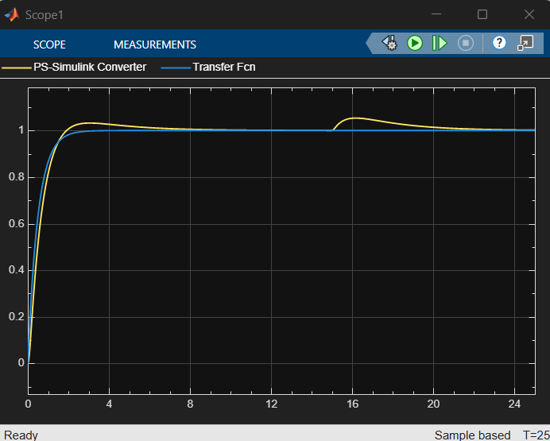
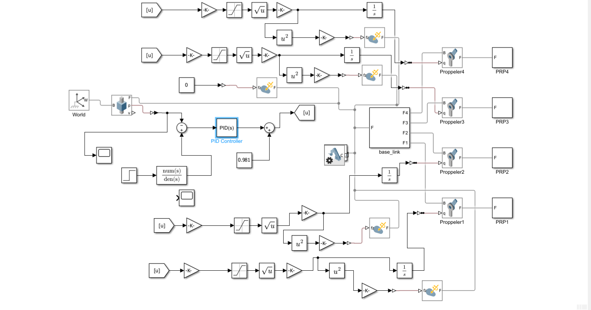
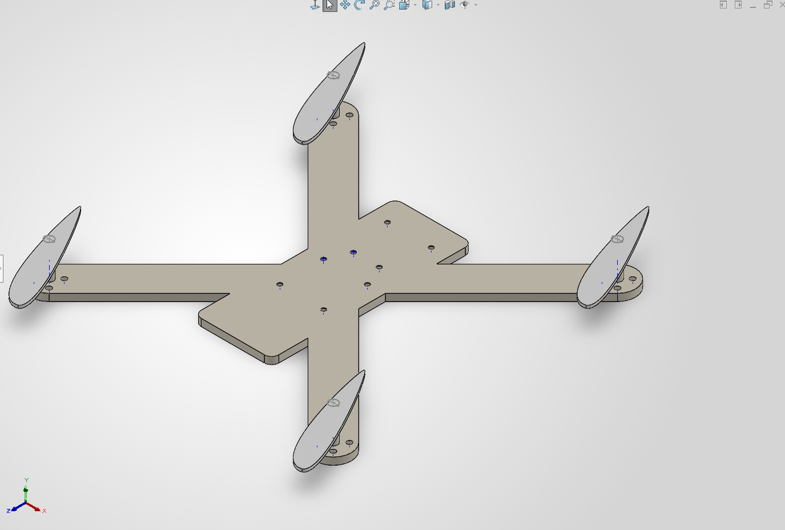

# Quadcopter Altitude Control Under a Wind Disturbance (Simulink + Simscape Multibody)

A simulation of a quadcopter that holds an altitude of 1 m with a PID controller and recovers after an upward wind-like force is applied. The drone was designed in SolidWorks and simulated in Simscape Multibody, with the controller built in Simulink.

> **Scope of this project:** simulation only. It is a single-axis (vertical) model and the wind is a constant force step, not an aerodynamic wind model. Nothing here has been validated on a real drone.

## Results

*Blue: reference altitude (1 m). Yellow: simulated drone altitude. 25 s run.*

Values read from the scope (approximate):

| Item | Value |
|---|---|
| Overshoot after start-up | about 3% |
| Settling to 1 m | about 8 s |
| Disturbance | 0.2 N upward step at t = 15 s |
| Peak altitude deviation | about 0.05 m |
| Recovery to 1 m after the gust | about 6 s |

## Model

- **Mechanical model:** SolidWorks assembly (frame and four propellers) brought into Simscape Multibody. The drone is connected to the World frame through a **prismatic joint**, so it moves along the vertical axis only. Joint damping: 0.5 N/(m/s).
- **Height controller:** PID on the error between the 1 m reference (a step passed through a first-order filter) and the measured height. A **0.981 N feedforward** (m·g for 0.10 kg) cancels gravity.
- **Propeller chains (x4):** control command ÷ 4, saturation (0 to 1), square root to get propeller speed ω, then an integrator to spin each propeller joint. Thrust **T = kT·ω²** is applied as a force on the drone body.
- **Disturbance:** a separate External Force and Torque block driven by a Step block (0 to 0.2 N at 15 s).

### Parameters

| Parameter | Value | Note |
|---|---|---|
| Drone mass | about 0.10 kg | `base_link` is 0.0894 kg in the model |
| Gravity | 9.80665 m/s² | Mechanism Configuration block |
| PID | P = 3, I = 1, D = 1.1, N = 100 | parallel form, continuous time |
| kT (thrust constant) | 1e-5 | **assumed**, not measured |
| Disturbance | 0.2 N step at 15 s | about 20% of the drone's weight |
| Simulation time | 25 s | |

## How to run

1. Requires MATLAB, Simulink and Simscape Multibody (add your MATLAB release here).
2. Open `Assem1.slx` in MATLAB.
3. Press **Run** (stop time 25 s).
4. Open the Scope to see the reference (blue) and drone altitude (yellow).

## Limitations

- One degree of freedom: no roll, pitch, yaw or sideways motion.
- The wind is a constant vertical force step, not an aerodynamic drag model, and it has no randomness.
- kT and the mass are assumed or taken from CAD, not measured.
- No sensor model, noise or delay; the controller sees the true height.
- No hardware validation.

## Next steps

- Replace the force step with gust profiles (for example 5, 8 and 10 m/s) using a drag-force model.
- Add a 6-DOF joint so the drone can tilt and drift sideways.
- Add attitude and position control with a motor mixer.
- Add sensor models and noise, then test on hardware.

## Credits

This simulation is part of a team Integrated Design Project on drone wind-disturbance recovery (Mechatronics Engineering Technology, Lincoln University Malaysia). Add the names of your teammates and supervisor here if they agree.
